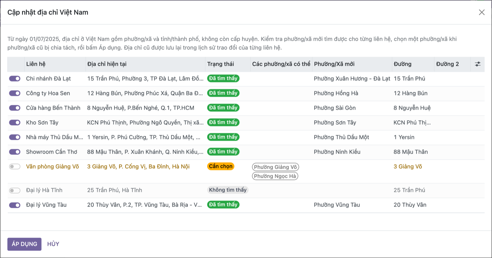

# Odoo Vietnam addresses after the 2025 reform

On 1 July 2025 Vietnam went from three levels of address (province, district, ward) to two:
63 provinces became 34, districts were abolished and about 10,000 wards became 3,321.
Odoo still ships the 63 old provinces and has no list of wards.

`l10n_vn_address` (Odoo 16) brings the current units into Odoo and moves your existing
contacts to them.



## What it does

- **The 34 current provinces.** The provinces that were merged stay in the database so old
  addresses still display, but they are no longer offered when you pick a province.
- **The 3,321 current wards**, with their postal code. Picking a ward in a contact fills the
  province and the ZIP.
- **Search without diacritics.** "ba dinh" finds "Phường Ba Đình", and "ho chi minh" finds
  "Hồ Chí Minh".
- **Address form in Vietnamese order** when your company is in Vietnam: street, ward, province.
- **A tool to update existing contacts** (Contacts › Configuration › Update Vietnamese
  addresses, or Action on selected contacts). It reads the old address as people actually
  write it ("P.Bến Nghé, Q.1, TP.HCM", "Phường 3, TP Đà Lạt", contacts without a country)
  and finds the ward it belongs to now. You review the list before anything changes:
  - **Found**: one new ward. The street line is cleaned of the old ward and district.
  - **Pick one**: the old ward was split. The possible wards are listed.
  - **Not found**: the address has no ward to go by.

  The previous address is kept in each contact's chatter.

How well it finds the ward: every one of the 10,034 old wards that have a successor,
written as "Phường X, Quận Y" or abbreviated as "P.X, Q.Y", comes back with the right
ward(s). When the kinds are left out ("Phúc Xá, Ba Đình"), 92% come back right. The rest are
mostly not found or offered as a choice, and 3 point to a wrong ward. These are names shared
by a ward and its province, like "Chi Lăng, Lạng Sơn, Lạng Sơn". That is why nothing
changes before you review it.

## Install

1. Copy `l10n_vn_address` into your addons path.
2. Install **Vietnam - Addresses after the 2025 reform**. It depends on `contacts` and
   `base_address_extended`.

The interface is in English and Vietnamese.

## Data

The units come from public datasets, both MIT licensed (see
[`data/NOTICE`](l10n_vn_address/data/NOTICE)):

- [vietnamese-provinces-database](https://github.com/ThangLeQuoc/vietnamese-provinces-database)
  v5.2.0, built from the General Statistics Office API. It includes the changes up to
  resolution 388/NQ-UBTVQH16 (20/09/2026).
- [dvhcvn/20250701](https://github.com/dvhcvn/20250701), which says which new ward(s) each
  old ward became, per the 2025 resolutions of the National Assembly Standing Committee.

`tools/build_data.py` rebuilds the data files from pinned versions of both.

## Tests

```sh
odoo -d test -i l10n_vn_address --test-enable --test-tags /l10n_vn_address --stop-after-init
```

## License

LGPL-3
